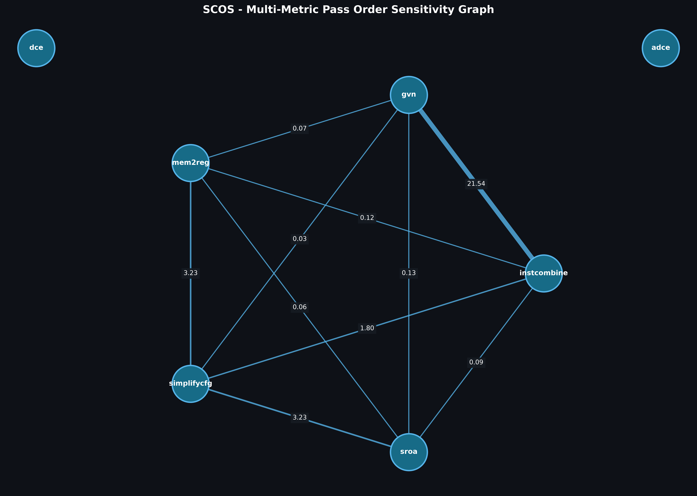

# SCOS — Smart Compiler Optimization System

**An experimental LLVM-based compiler optimization analysis and recommendation system.**

SCOS explores how the ordering of compiler optimization passes affects LLVM Intermediate Representation (IR), evaluates optimization sequences, benchmarks their execution performance, and generates workload-specific recommendations.

---

## Overview

Traditional compiler optimization pipelines apply predefined sequences of optimization passes. SCOS investigates whether selected pass sequences can produce useful results for different types of programs.

The system analyzes seven LLVM optimization passes, explores ordered combinations of two and three passes, evaluates their effects on LLVM IR, and compares their runtime performance against standard LLVM optimization levels.

## Key Features

- **LLVM IR Analysis:** Generates and analyzes LLVM Intermediate Representation.
- **Individual Pass Testing:** Tests seven LLVM optimization passes independently.
- **Pass-Order Sensitivity Analysis:** Measures differences between pass sequences in opposite orders.
- **Multi-Metric Analysis:** Evaluates instruction count, loads, stores, branches, calls, and IR size.
- **Optimization Graph:** Visualizes measured relationships between optimization passes.
- **Sequence Search:** Evaluates 252 ordered combinations of two and three distinct passes.
- **Multi-Workload Benchmarking:** Tests arithmetic, branch-heavy, array-processing, and function-heavy programs.
- **Recommendation Engine:** Selects workload-specific strategies using measured execution times and a configurable improvement threshold.
- **Interactive Dashboard:** Displays performance comparisons, optimization graphs, recommendations, and reports.

## Architecture

```text
                    C Benchmark Programs
                            |
                            v
                     LLVM / Clang
                            |
                            v
                    LLVM IR Generation
                            |
                            v
                Individual Pass Testing
                            |
                            v
                Pass-Order Analysis
                            |
                            v
                Multi-Metric Analysis
                            |
                            v
              Optimization Sensitivity Graph
                            |
                            v
                Sequence Search Engine
                            |
                            v
                Multi-Workload Benchmarking
                            |
                            v
                Recommendation Engine
                            |
                            v
                  Streamlit Dashboard
```

## Optimization Passes

SCOS currently evaluates these seven LLVM passes:

| Pass | Purpose |
|---|---|
| `mem2reg` | Promotes eligible memory variables into SSA registers |
| `sroa` | Scalar replacement of aggregates |
| `instcombine` | Simplifies and combines instructions |
| `simplifycfg` | Simplifies control-flow graphs |
| `dce` | Dead code elimination |
| `adce` | Aggressive dead code elimination |
| `gvn` | Global value numbering |

## Multi-Workload Evaluation

SCOS uses four benchmark programs:

| Workload | Focus |
|---|---|
| Arithmetic | Arithmetic operations and iterative computation |
| Branch Heavy | Conditional branches and control flow |
| Array Processing | Memory access, array transformations, and reductions |
| Function Heavy | Function calls and repeated computations |

The sequence search evaluates:

- 42 ordered sequences containing two distinct passes.
- 210 ordered sequences containing three distinct passes.
- **252 total sequences per workload.**

The system benchmarks the original O0 IR, custom sequences, and standard LLVM O1, O2, and O3 middle-end pipelines.

## Experimental Results

The following are results from one evaluation run on the development machine. Performance measurements may vary across hardware and operating systems.

| Workload | Best measured strategy | Speedup vs O0 |
|---|---|---:|
| Arithmetic | Original O0 | 1.0000x |
| Branch Heavy | Original O0 | 1.0000x |
| Array Processing | LLVM O2 | 1.0710x |
| Function Heavy | LLVM O1 | 2.3968x |

The experiments demonstrate that different workloads can respond differently to compiler optimization.

SCOS uses a 5% minimum measured improvement threshold when generating recommendations. If no candidate meets this threshold, it recommends retaining the baseline.

## Optimization Graph

The pass-order sensitivity graph represents optimization passes as nodes and measured positive order-sensitivity scores as weighted edges.



The sensitivity score is an experimental heuristic based on normalized differences across six LLVM IR metrics. It is not a proof of formal compiler-pass dependency.

## Technology Stack

| Technology | Usage |
|---|---|
| C | Benchmark programs |
| LLVM / Clang | Compilation and LLVM IR generation |
| Python | Analysis and benchmark automation |
| NetworkX | Graph construction |
| Matplotlib | Graph visualization |
| Pandas | Experimental result handling |
| Streamlit | Interactive dashboard |

## Project Structure

```text
Compiler_Design_Project/
│
├── README.md
│
└── SCOS/
    ├── app.py
    ├── requirements.txt
    ├── .gitignore
    │
    ├── benchmarks/
    │   ├── benchmark.c
    │   └── workloads/
    │       ├── arithmetic.c
    │       ├── branch_heavy.c
    │       ├── array_processing.c
    │       └── function_heavy.c
    │
    ├── graphs/
    │   ├── multimetric_optimization_graph.png
    │   └── multimetric_optimization_graph.graphml
    │
    ├── results/
    │   └── Generated benchmark results and reports
    │
    └── src/
        ├── benchmark.py
        ├── ir_analyzer.py
        ├── pass_tester.py
        ├── pass_dependency.py
        ├── pair_metrics.py
        ├── order_sensitivity.py
        ├── odg_generator.py
        ├── sequence_search.py
        ├── sequence_benchmark.py
        ├── fair_comparison.py
        ├── reference_benchmark.py
        ├── multi_benchmark.py
        ├── recommendation_engine.py
        └── multi_recommendation.py
```

## Installation

### Prerequisites

- macOS with Homebrew (the current scripts use Homebrew's LLVM location).
- Python 3.14 or a compatible Python environment.
- LLVM and Clang.
- Git.

### 1. Clone the repository

```bash
git clone https://github.com/Madhav-Soni/Compiler_Design_Project.git
cd Compiler_Design_Project/SCOS
```

### 2. Create a virtual environment

```bash
python3 -m venv .
